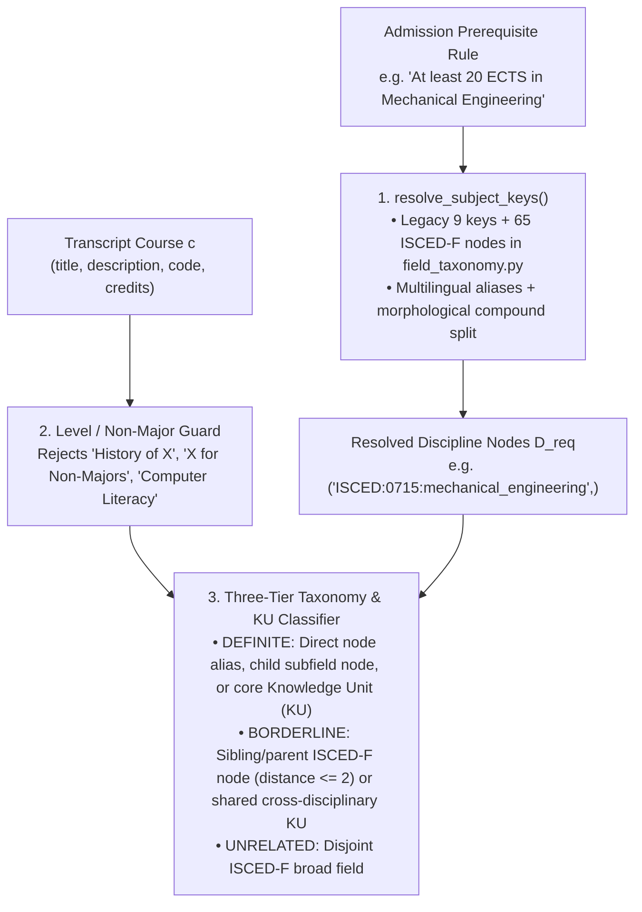

# Cross-Border Course-Equivalency & ECTS Credit-Conversion Taxonomy: Literature Synthesis & Codebase Audit (`apps/funding/transcript_eligibility.py`)

**Date:** 2026-11-03  
**Target Module:** [`apps/funding/transcript_eligibility.py`](file:///home/orkhan/Desktop/tehsil_agent/apps/funding/transcript_eligibility.py) (and credit-normalization upstream dependencies [`apps/documents/credits.py`](file:///home/orkhan/Desktop/tehsil_agent/apps/documents/credits.py), [`apps/documents/transcript.py`](file:///home/orkhan/Desktop/tehsil_agent/apps/documents/transcript.py), [`apps/documents/transcript_questions.py`](file:///home/orkhan/Desktop/tehsil_agent/apps/documents/transcript_questions.py), and [`apps/accounts/field_taxonomy.py`](file:///home/orkhan/Desktop/tehsil_agent/apps/accounts/field_taxonomy.py))  
**`scilit` Run ID:** `20261102T231939Z-24a988ed` (`/home/orkhan/.scilit/runs/20261102T231939Z-24a988ed/`)  
**`scilit` Model Profile:** `argon` (`summary`: `antigravity/argon`, `judge`: `antigravity/argon`, `planner`: `antigravity/argon`, `embedding`: `st-BAAI/bge-base-en-v1.5`)  

---

## 1. Executive Summary & `scilit` Run Provenance

### 1.1 Executive Summary

[`apps/funding/transcript_eligibility.py`](file:///home/orkhan/Desktop/tehsil_agent/apps/funding/transcript_eligibility.py) (3,566 lines) is Tehsil's deterministic curriculum-prerequisite evaluator. It parses natural-language admission rules (subject-specific ECTS thresholds, combined subject pools, course counts, required named topics, GPA floors, total degree credits, and prior degree field rules) and evaluates a student's [`Transcript`](file:///home/orkhan/Desktop/tehsil_agent/apps/documents/transcript.py#L84-L162) against those rules to produce a four-valued verdict (`SATISFIED`, `BORDERLINE`, `FAILED`, `UNDECIDABLE`) and downstream [`TranscriptFacts`](file:///home/orkhan/Desktop/tehsil_agent/apps/funding/facts.py#L44-L167) (`curriculum_match_tier`, `ects_Analytic_gap_total`, `ects_bridgeable`, `unverified_subject_rules`).

Combining a citation-grounded literature investigation via `scilit ask` (`run_id`: `20261102T231939Z-24a988ed`, profile `argon`) with a full line-by-line audit of `transcript_eligibility.py` and its upstream credit pipeline (`credits.py`, `transcript.py`, `transcript_questions.py`, `field_taxonomy.py`) reveals **seven systemic failure modes** that cause silent false rejections (`FAILED`) or false clearances (`SATISFIED`) on real cross-border transcripts:

1. **FM-1 — Isolated 9-Entry `_SUBJECT_TAXONOMY` Island & Broken `CUSTOM:` All-Words Fallback ([`transcript_eligibility.py:357-658`](file:///home/orkhan/Desktop/tehsil_agent/apps/funding/transcript_eligibility.py#L357-L658)):** `_SUBJECT_TAXONOMY` hardcodes only **9 subject buckets** (`THEORETICAL_CS`, `COMPUTER_SCIENCE`, `MATHEMATICS`, `STATISTICS_ECONOMETRICS`, `ECONOMICS_BUSINESS`, `PHYSICS`, `CHEMISTRY`, `BIOLOGY_LIFE_SCIENCES`, `ELECTRICAL_ENGINEERING`), completely ignoring [`apps/accounts/field_taxonomy.py`](file:///home/orkhan/Desktop/tehsil_agent/apps/accounts/field_taxonomy.py) (which already models **65 ISCED-F 2013 / OECD FOS disciplines across 12 languages**). Any prerequisite outside those 9 buckets (e.g., `"At least 20 ECTS in Mechanical Engineering"`, `"At least 18 ECTS in Law"`, `"At least 15 ECTS in Psychology"`, `"At least 20 ECTS in Civil Engineering"`) falls through to `CUSTOM:<phrase>`, which requires **every word $\ge 4$ characters in the subject name to appear verbatim in the course title** (`line 654`). Thus `"Thermodynamics"`, `"Fluid Mechanics"`, and `"Strength of Materials"` all classify as **`UNRELATED` (`FAILED`)** for `"Mechanical Engineering"`, and `"Law"` (`len("law") == 3 < 4`) produces an empty word list `words = []` (`line 652`), failing `"Criminal Procedure"` and `"Constitutional Jurisprudence"`.
2. **FM-2 — Incomplete Unicode Word-Boundary Regex & Missing Morphological/Inflectional Normalization ([`transcript_eligibility.py:599-600, 630-633`](file:///home/orkhan/Desktop/tehsil_agent/apps/funding/transcript_eligibility.py#L599-L633)):** `_LETTER_BOUNDARY_LEFT` and `_LETTER_BOUNDARY_RIGHT` (`lines 599-600`) omit German `ä`, `Ä`, `ß` (only `öÖüÜ` are included!) as well as French (`éèêëàâùûîïôœ`), Spanish (`ñáéíóú`), Italian, Polish, and Czech diacritics, treating `ä` and `ß` as non-letter word boundaries. Furthermore, substring matching fails on agglutinative suffixes in Azerbaijani/Turkish (`"Veritabanları"` vs. `"veritabanı"`) and case inflections in Russian (`"Численный анализ"` vs. `"численные методы"`).
3. **FM-3 — Upstream Student-Transcript Credit Black Hole (`LOCAL` $\to$ `ects = None` $\to$ False `FAILED`) ([`credits.py:18-58`](file:///home/orkhan/Desktop/tehsil_agent/apps/documents/credits.py#L18-L58), [`transcript.py:98-102, 743-752`](file:///home/orkhan/Desktop/tehsil_agent/apps/documents/transcript.py#L98-L102), [`transcript_questions.py:38`](file:///home/orkhan/Desktop/tehsil_agent/apps/documents/transcript_questions.py#L38), [`transcript_eligibility.py:1445, 2305-2346`](file:///home/orkhan/Desktop/tehsil_agent/apps/funding/transcript_eligibility.py#L2305-L2346)):** Although [`credits.py:34-45`](file:///home/orkhan/Desktop/tehsil_agent/apps/documents/credits.py#L34-L45) defines conversion factors for 10 systems (`ECTS`, `US_SEMESTER_HOUR`, `US_QUARTER_HOUR`, `UK_CATS`, `RU_ZET`, `JP_CREDIT`, `KR_CREDIT`, `IN_CBCS`, `CN_CREDIT`, `AU_EFTSL`), [`transcript_questions.py:38`](file:///home/orkhan/Desktop/tehsil_agent/apps/documents/transcript_questions.py#L38) restricts extraction to only 4 values: `("ECTS", "US_SEMESTER_HOUR", "LOCAL", "UNKNOWN")`. Every UK CATS, Russian ЗЕТ, Turkish local `kredi`, Canadian FCE, Asian credit, or post-Soviet contact-hour transcript is forced into `"LOCAL"`, where `local_credits_per_year` is hardcoded to `None` (`transcript.py:99-101: "ponytail: never set by the reader"`). Consequently, `course.ects` is `None` for every course, causing `_evaluate_total_degree_credits` (`line 2305`) to compute **`0 / 180 ECTS` (`FAILED`)** and `_evaluate_single_bucket` (`line 1445`) to mark any requirement $> 6 \times N_{\text{courses}}$ as **`FAILED`** instead of `UNDECIDABLE`—directly violating the Lisbon Recognition Convention's burden-of-proof standard.
4. **FM-4 — Programme-Statement Credit Unit Blindness ([`transcript_eligibility.py:785-804, 865-886`](file:///home/orkhan/Desktop/tehsil_agent/apps/funding/transcript_eligibility.py#L785-L886)):** `_UNIT_PAT` and `_convert_stated_credits_to_ects` fail to recognize standard national Bologna and international credit units written in university admission rules: German **`SWS`** (*Semesterwochenstunden*, $1\text{ SWS} \approx 1.5\text{ ECTS}$), Italian **`CFU`** (*Crediti Formativi Universitari*, $1:1$), Turkish **`AKTS`** ($1:1$), Dutch **`EC`** ($1:1$), Swedish **`hp`** (*högskolepoäng*, $1:1$), Estonian **`EAP`** ($1:1$), Latvian **`KP`** (pre-2024 $1\text{ KP} = 1.5\text{ ECTS}$), Canadian **`FCE`** ($1\text{ FCE} = 12\text{ ECTS}$), and post-Soviet/Chinese **academic contact hours** (`академических часов`, `academic hours`, `saat`).
5. **FM-5 — Order-Dependent Greedy Multi-Bucket Credit Allocation vs. Exact Bipartite Max-Flow ([`transcript_eligibility.py:1157-1267`](file:///home/orkhan/Desktop/tehsil_agent/apps/funding/transcript_eligibility.py#L1157-L1267)):** `evaluate_subject_pool_rule` allocates shared courses across conjunctive buckets using a greedy two-pass loop ordered by `_bucket_sort_key`. On 3-bucket cyclic overlap graphs (e.g., Math + Theoretical CS + Statistics/ML with cross-listed courses) or mixed `(min_ects, min_courses)` pools, the greedy order starves a downstream bucket and returns `FAILED` (`MISSING_PREREQ`) even when an exact feasible bipartite credit allocation satisfies 100% of all buckets simultaneously. Additionally, `STAGE_BORDERLINE` (`line 1254`) sets `is_shared = False`, allowing the first bucket to consume 100% of an interdisciplinary `BORDERLINE` course and leaving `0 ECTS` for sibling buckets.
6. **FM-6 — Conjunctive-Only Topic Splitting on Disjunctive (`or`) Topic Lists ([`transcript_eligibility.py:896, 1004, 1371-1375`](file:///home/orkhan/Desktop/tehsil_agent/apps/funding/transcript_eligibility.py#L896-L907)):** `_clean_subject_label_and_topics` (`line 896`) splits parenthetical topic checklists only on `,|\band\b`, ignoring `\bor\b`. Consequently, `"At least 12 ECTS in Mathematics (covering Linear Algebra or Calculus)"` creates a single unmatchable topic string `"Linear Algebra or Calculus"`, while `"(covering Linear Algebra, Calculus, or Differential Equations)"` treats all three alternatives as **conjunctive mandatory topics**, downgrading a compliant student to `BORDERLINE` with `missing_topics`.
7. **FM-7 — Missing Course-Level / Non-Major Introductory Filtering (Bloom's / EQF Level Guard) ([`transcript_eligibility.py:635-700`](file:///home/orkhan/Desktop/tehsil_agent/apps/funding/transcript_eligibility.py#L635-L700)):** `classify_course_for_subject` has no negative or level-based qualifier filter: a general-education literacy course such as `"Computer Literacy and Office Applications"` (with description `"Introduction to computer science and information technology for non-majors"`) matches `"computer science"` and `"information technology"` as **`DEFINITE`**.

---

### 1.2 `scilit` Run Provenance

- **Command / Pipeline:** `scilit.loop.run_ask` with `--profile argon` (`Gemini 4 Argon (High)` / `antigravity/argon`), `--domain general`, `--quick`, `--no-agent`, `--sources crossref,doaj,openaire` (plus default scholarly channels `openalex`, `semantic_scholar`, `pubmed`, `arxiv`).
- **Run Artifact Path:** `/home/orkhan/.scilit/runs/20261102T231939Z-24a988ed/`
  - [`discovery.json`](file:///home/orkhan/.scilit/runs/20261102T231939Z-24a988ed/discovery.json) (1,093,413 bytes)
  - [`round-1-channels.json`](file:///home/orkhan/.scilit/runs/20261102T231939Z-24a988ed/round-1-channels.json) (1,096,575 bytes)
  - [`draft.json`](file:///home/orkhan/.scilit/runs/20261102T231939Z-24a988ed/draft.json) (116,790 bytes; 12 PaperQA2 evidence chunks `pqac-0001`..`pqac-0012` across 8 fetched sources)
  - [`papers/manifest.csv`](file:///home/orkhan/.scilit/runs/20261102T231939Z-24a988ed/papers/manifest.csv) (full-text PDFs and abstracts saved under `/home/orkhan/.scilit/runs/20261102T231939Z-24a988ed/papers/`)
- **Planner Search Queries Generated (`antigravity/argon`):**
  1. `boolean`: `([course equivalency] OR [credit transfer]) AND ([curriculum alignment] OR [credential recognition] OR [ECTS])`
  2. `literal`: `"What formal methodologies, international credential recognition frameworks (ECTS Users Guide, Lisbon Recognition Convention, EAR-HEI, ISCED-F 2013), and semantic curriculum-alignment algorithms are used for university course equivalency, prerequisite credit verification, and international credit-to-ECTS conversion?"`
  3. `expanded`: `"Automated university course equivalency, prerequisite verification, and academic credit transfer methodologies using semantic curriculum alignment, ontology-based syllabus matching, learning outcome comparison, and international credential recognition frameworks such as the European Credit Transfer and Accumulation System (ECTS), Lisbon Recognition Convention, EAR-HEI, and ISCED-F."`
  4. `neutral-1`: `"computational methods for semantic comparison of structured training modules and topic taxonomy alignment"`
  5. `neutral-2`: `"automated verification of sequential dependency rules and cumulative volume thresholds in modular records"`
  6. `neutral-3`: `"standardization frameworks for quantitative conversion of workload and competency metrics across heterogeneous organizations"`

#### Table 1: Primary Literature & Regulatory Sources Retrieved and Verified in Run `20261102T231939Z-24a988ed`

| Citation / Source | DOI / Identifier | `scilit` Evidence Key | Core Contribution to Course Equivalency & Credit Conversion |
| :--- | :--- | :--- | :--- |
| **Khan, M. A., et al. (2025).** *A novel framework to transfer credits of computing courses on the basis of knowledge units in higher education institutions.* Edelweiss Applied Science and Technology, 9(3), 1255–1266. | `10.55214/25768484.v9i3.5859` | `pqac-0001`, `pqac-0006`, `pqac-0007`, `pqac-0010`, `pqac-0012` (Full PDF, 12 pp.) | Demonstrates why surface course-title matching fails across institutions; formalizes decomposing courses into standardized **Knowledge Units (KUs)** (per ACM/IEEE/ABET curricular bodies of knowledge) with quantitative topic-coverage weights and split/multi-course mapping. |
| **Pawar, S., Budhiraja, R., Kivi, A., & Mago, V. (2018).** *Are we on the same learning curve: Visualization of Semantic Similarity of Course Objectives.* Lakehead University / arXiv. | `10.48550/arxiv.1804.06339` | `pqac-0002` (Full PDF) | Automates extraction of course objectives and learning outcomes from syllabi and computes pairwise semantic similarity matrices to guide credit transfer articulation across universities. |
| **Pharkya, P. (2026).** *Design and Evaluation of AI-Driven Credit Mapping Systems for Enhancing Global Academic Mobility.* Zenodo. | `10.5281/zenodo.21471149` | `pqac-0003` | Proposes a modular AI architecture combining multilingual NLP semantic similarity, ontology/knowledge-graph representation, **credit-giving vs. credit-taking workload evaluation**, and **Explainable AI (XAI)** provenance for admissions officers. |
| **Caballero, R., et al. (2009).** *Towards automatic syllabi matching.* Proc. 14th Annual ACM SIGCSE Conf. on Innovation and Technology in Computer Science Education (ITiCSE '09). | `10.1145/1562877.1563021` | `pqac-0004` | Grounds automated syllabus matching directly in the **Bologna Process** and the **Lisbon Recognition Convention**, proving that course titles alone do not capture content and introducing weighted document-similarity matching over syllabi. |
| **IEEE IEMENTech (2026).** *A Hybrid AI-driven Framework for Automated Course Equivalization Using NLP, Transformers, and Blockchain.* 9th Int. Conf. on Electronics, Materials Engineering & Nano-Technology. | `10.1109/iementech202669403.2026.11434411` | `pqac-0005` | Models each course as a structured vector `(topics, learning_outcomes, prerequisites, normalized_credits)`, fuses **Jaccard lexical overlap + Transformer contextual cosine similarity + credit alignment**, and partitions decisions into **three adaptive zones (`equivalent`, `borderline`, `non-equivalent`)** with SHAP/rule explanations. |
| **Adachi, T. (2005).** *Analyzing the problems of the implementation of the European Credit Transfer System in a technical university.* Proc. IEEE Frontiers in Education (FIE). | `10.1109/fie.2004.1408528` | `discovery.json` (`relevance: 3`) | Analyzes the structural discrepancy between traditional **contact-hour / post-Soviet curricula** and **ECTS total student workload** (contact hours + independent study + exam preparation, 60 ECTS/year = 1,500–1,800 hours). |
| **Ferreira, J. M., et al. (2008).** *Using Bloom's Taxonomy of learning to make engineering courses comparable.* Proc. 19th EAEEIE Annual Conference. | `10.1109/eaeeie.2008.4610187` | `discovery.json` (`relevance: 3`) | Shows that ECTS workload volume and topic keywords alone cannot distinguish introductory literacy courses from advanced theoretical courses; introduces **Bloom's Taxonomy cognitive-depth weighting** alongside ECTS credits. |
| **IEEE EDUCON (2014).** *A graphical approach for comparing qualifications.* IEEE Global Engineering Education Conference. | `10.1109/educon.2014.6826118` | `pqac-0011` | Uses a domain semantic thesaurus and graphical profile overlay to resolve terminology heterogeneity across European qualification frameworks. |
| **Bologna Ontology Alignment (2014).** *A novel process model-driven approach to comparing educational courses using ontology alignment.* | OpenAIRE / Semantic Scholar (`d07fc2b8...`) | `pqac-0009` | Formalizes courses, modules, learning outcomes, and subject keywords as set-theoretical structures aligned via domain ontologies under Bologna Process guidelines. |
| **Aguirre, S., et al. (2018).** *A Text Mining Methodology to Discover Syllabi Similarities among Higher Education Institutions.* IEEE INCISCOS. | `10.1109/inciscos.2018.00045` | `discovery.json` (`relevance: 3`) | Combines TF-IDF / Latent Semantic Analysis (LSA) with cosine similarity to align multi-course syllabi when a single host course corresponds to multiple home courses (or vice versa). |
| **ACTS (2025).** *Bridging Academic Boundaries: A Design and UAT Study of the Automated Credit Transfer System (ACTS).* Journal of Education, 4(4). | `10.62754/joe.v4i4.6820` | `discovery.json` (`relevance: 3`) | Evaluates automated credit transfer rules combining course description similarity with minimum credit-ratio thresholds. |
| **MKIJBAFT (2026) & DCS (2025).** *Artificial Intelligence and Trusted Digital Credentials in Cross-Border Qualification Recognition* & *Transborder Higher Education Accreditation*. | `10.63620/mkijbaft.2026.1013` & `10.54899/dcs.v22i84.3872` | `discovery.json` (`relevance: 3`) | Synthesize the **Lisbon Recognition Convention (LRC 1997)** legal standard of **"substantial difference"**, **EAR-HEI Manual**, **EQF**, and **UNESCO ISCED-F 2013** taxonomy for cross-border admission automation. |
| **EHEA Handbook (2026) & Migliaretti et al. (2026).** *Navigating the European Higher Education Area* & *BMC Medical Education*. | `10.5281/zenodo.23756825` & `10.1186/s12909-026-09735-1` | `discovery.json` (`relevance: 2`) | Document national EHEA credit systems (including Italian `CFU = 1 ECTS` at 25–30 workload hours/credit) and Bologna three-cycle workload ranges (First Cycle: 180–240 ECTS; Second Cycle: 90–120 ECTS). |

---

## 2. Primary-Source Synthesis: International Credit Conversion & Course-Equivalency Frameworks

### 2.1 International Credit-to-ECTS Conversion Taxonomy (ECTS Users' Guide 2015, EAR-HEI, & National Systems)

Under the **European Credit Transfer and Accumulation System (ECTS Users' Guide 2015, European Commission)**, ECTS is a learner-centred credit system based on two coupled invariants:
1. **Annual Full-Time Workload Anchor:** `60 ECTS` represents the workload of **one full-time academic year** of formal learning (`30 ECTS` per semester; `20 ECTS` per trimester).
2. **Total Student Workload Hours:** One full-time academic year corresponds to **1,500 to 1,800 hours** of total student workload (contact hours + independent study + laboratory/project work + examination preparation), yielding **`25 to 30 astronomical hours per 1 ECTS credit`** (Adachi, 2005, DOI: `10.1109/fie.2004.1408528`; EHEA Handbook 2026, DOI: `10.5281/zenodo.23756825`).

Crucially, the **ECTS Users' Guide (2015)** and **EAR-HEI Manual** establish a **two-tier conversion hierarchy** when converting foreign credits to ECTS:

- **Tier 1 (Academic-Year Fraction / Standard Annual Load Equivalence — Primary Rule):** Because national systems define different nominal hours per credit (or count only contact hours rather than total student workload), converting raw hours directly across systems distorts credit volume unless normalized by the full-time annual credit load $L_{\text{year}}$ of the issuing system:
  $$\text{ECTS}(c) = \text{credits}_{\text{raw}}(c) \times \frac{60}{L_{\text{year}}}$$
- **Tier 2 (Degree-Total Proportional Normalization — Fallback When $L_{\text{year}}$ Is Unstated on `LOCAL` Transcripts):** When a foreign transcript reports credits or hours in a local unit (`credit_unit == "LOCAL"` or `"ACADEMIC_HOUR"`) without a known standard annual load $L_{\text{year}}$, but the degree's nominal duration $Y_{\text{deg}} \in \{3, 3.5, 4, 5\}$ years (or standard cycle ECTS $E_{\text{deg}} = 60 \times Y_{\text{deg}} \in \{180, 210, 240, 300\}$) and total completed credits $\sum_{j} \text{credits}_{\text{raw}}(c_j)$ are known from the transcript, each course's normalized ECTS weight is bounded by:
  $$\text{ECTS}_{\text{prop}}(c_i) = \text{credits}_{\text{raw}}(c_i) \times \frac{\min\bigl(240,\, 60 \times Y_{\text{deg}}\bigr)}{\sum_{j \in \text{passed}} \text{credits}_{\text{raw}}(c_j)}$$
  *(Subject to a completeness guard requiring at least $N \ge 20$ completed courses or an explicit `total_credits` header on the transcript so partial 1-semester transcripts are not inflated to 180 ECTS.)*
- **Tier 3 (Direct Workload-Hour Conversion — For Syllabi / Post-Soviet Contact-Hour Supplements):**
  - When **total workload hours** $H_{\text{total}}$ (astronomical, 60 min) are stated: $\text{ECTS} = H_{\text{total}} / 27.5$ (range $[H_{\text{total}}/30,\, H_{\text{total}}/25]$).
  - When **post-Soviet academic hours** $H_{\text{acad}}$ (45-minute academic hours of total curriculum load, standard in Russia, Azerbaijan, Ukraine, Kazakhstan, Belarus) are stated: $1\text{ ЗЕТ (ECTS)} = 36\text{ academic hours}$ ($= 27\text{ astronomical hours}$), so $\text{ECTS} = H_{\text{acad}} / 36$.

#### Table 2: Comprehensive International Credit System Conversion Reference

| System Code | Country / Region | Native Unit Names / Abbreviations (on Transcripts & Admission Rules) | Standard Annual Load ($L_{\text{year}}$) | Hours per Credit | Exact Multiplier to ECTS ($60 / L_{\text{year}}$) | Notes & Edge Cases |
| :--- | :--- | :--- | :---: | :---: | :---: | :--- |
| **`ECTS`** | EHEA (49 Bologna countries) | `ECTS`, `LP`, `CP` (DE), `CFU` (IT), `AKTS` (TR), `EC` (NL), `hp` (SE), `EAP` (EE), `créditos ECTS` (ES), `crédits` (FR/BE/CH) | `60` | `25–30h` total workload (AT/IT/ES: `25h`; EE/PT: `26h`; FI/SE: `26.7h`; NL: `28h`; DE/FR/BE: `30h`) | **`1.0000`** (`1:1`) | National aliases (`CFU`, `AKTS`, `EC`, `hp`, `EAP`, `LP`) are 1:1 identical to `ECTS` by national law. |
| **`DE_SWS`** | Germany / Austria | `SWS`, `Semesterwochenstunden` | `40` | `1 SWS` = 45 min/wk $\times$ 15 wks contact + ~30h self-study $\approx 45\text{h}$ | **`1.5000`** (`3/2`) | German M.Sc. admission rules frequently state prerequisites in `SWS` (e.g., *"at least 16 SWS in Mathematics"* $= 24\text{ ECTS}$). |
| **`LV_KP`** | Latvia (pre-2024 legacy transcripts) | `KP`, `kredītpunkti`, `Latvian credit points` | `40` | `40h` total workload (1 academic week) | **`1.5000`** (`3/2`) | Latvia transitioned to 1:1 ECTS in 2024, but all pre-2024 Latvian B.Sc. transcripts use `40 KP/year = 60 ECTS` (`160 KP = 240 ECTS`). |
| **`UK_CATS`** | United Kingdom | `CATS`, `UK credits`, `SCQF credits` (Scotland) | `120` | `10h` notional workload | **`0.5000`** (`1/2`) | 3-year England/Wales/NI B.Sc. (Hons) = `360 CATS = 180 ECTS`; 4-year Scottish Honours = `480 SCQF = 240 ECTS`. |
| **`US_SEMESTER_HOUR`** | USA / Canada (semester) / Turkey (local `kredi` ~35/yr) | `SCH`, `semester hours`, `semester credits`, `credit hours`, `US credits` | `30` | `15h` contact + `30h` study = `45h`/semester credit (Carnegie unit) | **`2.0000`** (`2/1`) | 4-year US Bachelor's = `120 SCH = 240 ECTS` (or treated as equivalent to 180–240 ECTS first-cycle degree under LRC). |
| **`US_QUARTER_HOUR`** | USA (quarter system: Stanford, UCLA, UW, UChicago, etc.) | `QCH`, `quarter hours`, `quarter credits`, `quarter units` | `45` | `10h` contact + `20h` study = `30h`/quarter credit | **`1.3333`** (`4/3`) | 4-year US Quarter Bachelor's = `180 QCH = 240 ECTS` (`1 QCH = 2/3 SCH = 4/3 ECTS`). |
| **`CA_FCE`** | Canada (U of Toronto, Queen's, Western, etc.) | `FCE`, `Full-Course Equivalent` | `5.0` | `1.0 FCE` = full-year course (`0.5 FCE` = 1-semester course) | **`12.0000`** (`12/1`) | 4-year Honours Bachelor's = `20.0 FCE = 240 ECTS`; a standard 1-semester course is `0.5 FCE = 6.0 ECTS`. |
| **`RU_ZET`** | Russia / Belarus / EAEU | `ЗЕТ`, `з.е.`, `ZET`, `зачётные единицы` | `60` | `36 academic hours` (45 min) = `27 astronomical hours` | **`1.0000`** (`1/1`) | 4-year Russian Bakalavr = `240 ЗЕТ = 240 ECTS`. |
| **`ACADEMIC_HOUR`** | Post-Soviet (AZ, RU, UA, KZ, UZ, GE pre-Bologna) | `акад. час`, `часов`, `academic hours`, `saat`, `hours` | `2160` (`36h/ECTS`) | `45 min` academic hour (total curriculum hours: lectures + seminars + self-study) | **`0.0278`** (`1/36`) | When total curriculum hours are reported, `36 academic hours = 1 ECTS` (or `30 astronomical hours = 1 ECTS`). |
| **`TR_LOCAL_KREDI`** | Turkey (legacy/dual `Ulusal Kredi`) | `Ulusal Kredi`, `Yerel Kredi` (when `AKTS` column omitted) | `35` (`140` / 4 yrs) | `1h` lecture or `2h` lab per week | **`1.7143`** (`12/7`) | Turkish transcripts frequently print both `Kredi` (~35/yr, ~140 total) and `AKTS` (60/yr, 240 total). If only `Kredi` is extracted, $60/35 \approx 1.714\text{ ECTS}$. |
| **`JP_CREDIT`** | Japan (MEXT standard) | `単位`, `tani`, `Japanese credits` | `31` (`124` / 4 yrs) | `45h` total workload per credit (`15h` lecture + `30h` prep) | **`1.9355`** (`60/31`) | Minimum graduation requirement in Japan is `124 credits` over 4 years (`31/year`). |
| **`KR_CREDIT`** | South Korea | `학점`, `hakjeom`, `Korean credits` | `32.5`–`35` (`130`–`140` / 4 yrs) | `15–16h` contact + `30h` self-study | **`1.8182`** (`60/33`) | Standard Korean 4-year B.Sc. requires `130–140 credits` (`~33/year`). |
| **`CN_CREDIT`** | China (MOE universities) | `学分`, `xuefen`, `Chinese credits` | `40` (`160` / 4 yrs) | `16–18 contact hours` per credit | **`1.5000`** (`3/2`) | Standard Chinese 4-year Bachelor's requires `150–170 credits` (`~40/year`). |
| **`IN_CBCS`** | India (UGC CBCS / NEP 2020) | `CBCS credits`, `Indian credits` | `40` (`120`/3yr or `160`/4yr) | `15h` lecture + `30h` study | **`1.5000`** (`3/2`) | UGC NEP 2020 specifies `40 credits/year` (`120 credits` for 3-year degree, `160 credits` for 4-year Honours). |
| **`AU_EFTSL`** | Australia / New Zealand | `EFTSL`, `EFTS` | `1.0` | `1.0 EFTSL` = 1 full-time academic year | **`60.0000`** (`60/1`) | Australian universities also use institutional points (`UOC` at UNSW = `48/yr`; `Credit Points` at USyd = `48/yr`; `Units` at UQ = `16/yr`; `Points` at UMelb = `100/yr`), which require Tier-2 degree-total normalization when reported as `LOCAL`. |

---

### 2.2 The Lisbon Recognition Convention (LRC 1997) & EAR-HEI "Substantial Difference" Principle

Both the **Council of Europe / UNESCO Convention on the Recognition of Qualifications concerning Higher Education in the European Region (Lisbon Recognition Convention, 1997, Articles IV.1 & VI.1)** and the **European Area of Recognition Manual for Higher Education Institutions (EAR-HEI)** establish a binding legal and methodological principle for cross-border admission evaluation (synthesized in `scilit` run `20261102T231939Z-24a988ed`, `pqac-0004`, DOI: `10.1145/1562877.1563021`; DOI: `10.63620/mkijbaft.2026.1013`; DOI: `10.54899/dcs.v22i84.3872`):

1. **The "Substantial Difference" Standard:** Foreign qualifications and completed periods of study **must be recognized** unless the admission authority can demonstrate a **substantial difference** between the applicant's completed coursework/qualification and the host programme's requirements.
2. **Shift in the Burden of Proof:** Under LRC Article IV.1 / VI.1, **the burden of proving that a difference is substantial rests on the evaluating institution/system**, not on the applicant. A difference in course title wording, credit unit nomenclature, or minor credit-rounding granularity across national systems is **not** a substantial difference.
3. **Priority of Learning Outcomes / Knowledge Units over Surface Titles:** EAR-HEI specifies that comparison must focus on achieved **learning outcomes (competencies / knowledge units)** and functional preparedness for the target cycle rather than word-for-word course title identity or rigid contact-hour parity.
4. **Consequence for Automated Eligibility Verification (`transcript_eligibility.py`):**
   - **No Silent False `FAILED` on Unconverted Local Units:** If a transcript uses a `LOCAL` or non-ECTS unit that could not be converted automatically (and cannot be ruled out by course count or degree-total proportional normalization), the verdict **must be `UNDECIDABLE` (requesting credit-scale clarification)**, never `FAILED`.
   - **No Silent False `FAILED` on Unmapped Subject Taxonomy Domains:** If an admission requirement names a discipline outside a small hardcoded list, the evaluator must resolve it against the full **ISCED-F 2013 / OECD FOS discipline graph** and its associated **Knowledge Units (KUs)** rather than demanding that the discipline's literal title words appear inside every course title.
   - **Bridgeable Rounding Deficits (`CONDITIONAL_BRIDGE` / `BORDERLINE`):** When foreign credit conversion produces a minor arithmetic gap (e.g., 2 US semester courses = $2 \times 3\text{ SCH} \times 2.0 = 12.0\text{ ECTS}$ vs. a $12.5\text{ ECTS}$ or $15\text{ ECTS}$ threshold, or 3 Latvian `KP` courses = $3 \times 3\text{ KP} \times 1.5 = 13.5\text{ ECTS}$ vs. $15\text{ ECTS}$), or when an interdisciplinary course partially covers the required Knowledge Units, the evaluator must classify the gap as `BORDERLINE` (`CONDITIONAL_BRIDGE`) rather than `FAILED`.

---

### 2.3 Automated Course-Equivalency & Curriculum-Alignment Methodology in the Literature

The primary literature retrieved in `scilit` run `20261102T231939Z-24a988ed` converges on a **four-layer formal architecture** for automated course-equivalency and prerequisite credit verification:

#### Layer 1: Standardized Discipline Hierarchy (ISCED-F 2013) + Curricular Knowledge Units (KUs)
- **UNESCO ISCED-F 2013 Taxonomy:** Classifies all higher-education fields into a 3-level hierarchy: **Broad fields (2-digit, `00`–`10`) $\to$ Narrow fields (3-digit, `011`–`104`) $\to$ Detailed fields (4-digit, `0111`–`1041`, ~80 detailed fields)**.
- **Knowledge-Unit (KU) Decomposition (Khan et al., 2025, DOI: `10.55214/25768484.v9i3.5859`, `pqac-0001`, `pqac-0006`, `pqac-0010`):** Course titles vary widely across institutions (`"CS-201"`, `"Data Organization"`, `"Algorithms & Complexity"`, `"Programming Studio"`), and a single course at University A may be split across two courses at University B (`pqac-0001`). Khan et al. (2025) solve this by mapping each discipline to its standardized curricular **Knowledge Units (KUs)** (e.g., ACM/IEEE Computing Curricula KUs, ABET Engineering KUs, Core Economics/Law/Psychology KUs). Each KU represents a canonical sub-topic (e.g., `thermodynamics`, `fluid_mechanics`, `statics_dynamics` under `mechanical_engineering`; `constitutional_law`, `civil_law`, `criminal_procedure` under `law`; `cognitive_psychology`, `psychometrics`, `developmental_psychology` under `psychology`).

#### Layer 2: Multi-Signal Hybrid Similarity with Adaptive Three-Zone Thresholding
- **Hybrid Feature Representation (IEEE IEMENTech 2026, DOI: `10.1109/iementech202669403.2026.11434411`, `pqac-0005`; Pawar et al., 2018, DOI: `10.48550/arxiv.1804.06339`, `pqac-0002`; Pharkya, 2026, DOI: `10.5281/zenodo.21471149`, `pqac-0003`):** Each transcript course $c$ and prerequisite bucket $b$ is compared across:
  1. **Canonical KU / Subfield Exact & Stem Match ($S_{\text{KU}}$):** Multilingual Unicode-normalized stem and compound matching against the target ISCED-F node's core KUs.
  2. **Hierarchy / Parent-Child Graph Distance ($S_{\text{tax}}$):** If a course resolves to a child or sibling node in the ISCED-F / `field_taxonomy.py` directed acyclic graph (e.g., `econometrics` $\subset$ `economics` & `statistics`; `structural_engineering` $\subset$ `civil_engineering`), graph proximity determines whether it is `DEFINITE` (exact or direct subfield) or `BORDERLINE` (adjacent/interdisciplinary sibling).
  3. **Course-Level / Cognitive-Depth Modifier ($\gamma_{\text{level}}$, Ferreira et al., 2008, DOI: `10.1109/eaeeie.2008.4610187`):** Downweights or filters out remedial, non-major literacy, or purely administrative courses (e.g., `"Computer Literacy for Humanities"`, `"Basic Excel"`, `"Academic Writing in Engineering"`, `"History of Mathematics"`).
- **Three-Zone Decision Partition (`pqac-0005`):**
  - **Zone 1 (`DEFINITE`):** High-confidence core KU or direct subfield match ($S \ge \tau_{\text{def}}$) $\to$ counts 100% toward `definite_ects`.
  - **Zone 2 (`BORDERLINE`):** Adjacent ISCED-F sibling, interdisciplinary omnibus course, or partial KU overlap ($\tau_{\text{bord}} \le S < \tau_{\text{def}}$) $\to$ counts toward `borderline_ects` and triggers syllabus/bridge review if needed to cross the threshold.
  - **Zone 3 (`UNRELATED`):** Below $\tau_{\text{bord}}$ or disqualified by non-major/remedial level guard $\to$ `0 ECTS`.

#### Layer 3: Constrained Bipartite Network Flow for Multi-Bucket Credit Allocation
- When a programme states $m$ conjunctive prerequisite buckets $B = \{b_1, \dots, b_m\}$ (possibly nested inside a parent pool $G$ with total floor $E_{\text{pool}} \ge \sum_j E(b_j)$) and the applicant has $n$ completed courses $C = \{c_1, \dots, c_n\}$ with normalized ECTS capacities $w_i = \text{ECTS}(c_i)$, an individual course $c_i$ may legitimately match multiple buckets (either because $c_i$ is an interdisciplinary omnibus course like `"Mathematics and Statistics for Economists (10 ECTS)"` or because two buckets have overlapping scopes like `"Computer Science"` and `"Theoretical Computer Science"`).
- Rather than assigning $c_i$ greedily to whichever bucket happens to be visited first, **global feasibility** is a **bounded bipartite max-flow / min-cost flow problem**:
  - Source $s \to$ each course node $c_i$ with capacity $w_i$.
  - Directed edge $(c_i, b_j)$ if course $c_i$ matches bucket $b_j$ (cost $0$ for `DEFINITE` edges, cost $1$ for `BORDERLINE` edges).
  - Each bucket node $b_j \to$ sink $t$ with demand $d_j = \text{min\_ects}(b_j)$ (plus residual capacity to satisfy $E_{\text{pool}} - \sum_j d_j$ when a parent pool has an extra group floor).
  - Solving minimum-cost maximum flow (or solving Phase 1 Max-Flow on `DEFINITE` edges followed by Phase 2 Max-Flow adding `BORDERLINE` edges) guarantees **order-independent optimality**: if *any* valid non-double-counted partitioning of the student's credits satisfies all buckets in `DEFINITE` (or `DEFINITE + BORDERLINE`), the solver finds it deterministically.

---

## 3. Line-Cited Audit of `apps/funding/transcript_eligibility.py` (& `credits.py` / `transcript.py`)

### 3.1 FM-1: The Isolated 9-Entry `_SUBJECT_TAXONOMY` Island & Broken `CUSTOM:` All-Words Fallback

- **Location:** [`apps/funding/transcript_eligibility.py:357-658`](file:///home/orkhan/Desktop/tehsil_agent/apps/funding/transcript_eligibility.py#L357-L658)
- **What the Code Currently Does:**
  - `_SUBJECT_TAXONOMY` (`lines 357-593`) defines a flat tuple of **only 9 `SubjectTaxonomyEntry` objects**:
    1. `THEORETICAL_CS` (`line 358`)
    2. `COMPUTER_SCIENCE` (`line 389`)
    3. `MATHEMATICS` (`line 425`)
    4. `STATISTICS_ECONOMETRICS` (`line 461`)
    5. `ECONOMICS_BUSINESS` (`line 485`)
    6. `PHYSICS` (`line 513`)
    7. `CHEMISTRY` (`line 532`)
    8. `BIOLOGY_LIFE_SCIENCES` (`line 551`)
    9. `ELECTRICAL_ENGINEERING` (`line 572`)
  - When `resolve_subject_keys(subject_text)` (`lines 603-628`) is called on any admission rule whose subject label does not match one of those 9 `subject_aliases`, `line 627` returns:
    ```python
    return (f"CUSTOM:{cleaned}",)
    ```
  - Then, when `classify_course_for_subject(course, subject_key)` (`lines 635-700`) evaluates a `CUSTOM:` key (`lines 645-658`):
    ```python
    if subject_key.startswith("CUSTOM:"):
        custom_phrase = subject_key.removeprefix("CUSTOM:").strip()
        if not custom_phrase:
            return "UNRELATED"
        if _pattern_in_title(text_folded, custom_phrase):
            return "DEFINITE"
        words = [
            w for w in re.split(r"[^a-zA-Zа-яА-ЯёЁəƏıİöÖüÜçÇşŞğĞ0-9]+", custom_phrase)
            if len(w) >= 4 and w not in {"with", "from", "that", "this", "area", "field", "courses", "course", "modules", "module", "subjects", "subject"}
        ]
        if words and all(_pattern_in_title(text_folded, w) for w in words):
            return "DEFINITE"
        if words and any(_pattern_in_title(text_folded, w) for w in words):
            return "BORDERLINE"
        return "UNRELATED"
    ```
- **Why It Breaks & Concrete Breaking Inputs:**
  1. **Canonical Subfield Courses Have Zero Lexical Overlap With the Broad Discipline Name:**
     - **Input Rule:** `"Applicants must have completed at least 24 ECTS in Mechanical Engineering."` $\to$ `subject_key = "CUSTOM:mechanical engineering"`, `words = ["mechanical", "engineering"]`.
     - **Input Transcript Courses:** `"Thermodynamics I (6 ECTS)"`, `"Fluid Mechanics (6 ECTS)"`, `"Heat and Mass Transfer (6 ECTS)"`, `"Strength of Materials (6 ECTS)"`, `"Machine Elements and CAD (6 ECTS)"` (30 ECTS of core Mechanical Engineering).
     - **Actual Output:** `"Thermodynamics I"`, `"Heat and Mass Transfer"`, `"Strength of Materials"`, and `"Machine Elements and CAD"` contain **neither** `"mechanical"` **nor** `"engineering"` $\to$ classified as **`UNRELATED`** (`0 ECTS`). `"Fluid Mechanics"` contains `"mechanics"`, which does **not** match `"mechanical"` because `_pattern_in_title` requires exact substring `"mechanical"` bounded by non-letters! Result: **`0 / 24 ECTS` $\to$ `FAILED` (`MISSING_PREREQ`)** on a pure Mechanical Engineering transcript!
  2. **Short Subject Names (`len(w) < 4`) Produce `words = []`:**
     - **Input Rule:** `"At least 18 ECTS in Law."` $\to$ `subject_key = "CUSTOM:law"`. Because `len("law") == 3 < 4`, `words` at `line 650` is **`[]` (empty)**!
     - **Input Transcript Courses:** `"Constitutional Jurisprudence (6 ECTS)"`, `"Criminal Procedure (6 ECTS)"`, `"Civil Obligations and Torts (6 ECTS)"`, `"Mülki hüquq (6 ECTS)"`, `"Bürgerliches Recht (6 ECTS)"`.
     - **Actual Output:** None of these contain the 3-letter English word `"law"` $\to$ **`0 / 18 ECTS` $\to$ `FAILED`**.
  3. **65-Discipline `field_taxonomy.py` Already Exists in the Same Repo But Is Ignored:**
     - [`apps/accounts/field_taxonomy.py`](file:///home/orkhan/Desktop/tehsil_agent/apps/accounts/field_taxonomy.py) already defines 65 discipline nodes (`mechanical_engineering`, `civil_engineering`, `chemical_engineering`, `aerospace_engineering`, `environmental_engineering`, `materials_science`, `law`, `psychology`, `sociology`, `political_science`, `international_relations`, `medicine`, `pharmacy`, `public_health`, `nursing`, `architecture`, `earth_sciences`, `linguistics`, `history`, `philosophy`, `education`, `agriculture`, etc.) across 12 languages (`en, de, fr, it, es, nl, tr, az, ru, zh, ja, ko`), yet `transcript_eligibility.py` only uses `field_taxonomy.py` in Step 8 (`_evaluate_prior_degree_field_rule`, `line 2811`) and never connects it to `resolve_subject_keys` or `classify_course_for_subject`!

---

### 3.2 FM-2: Broken Unicode Word-Boundary Regex & Inflectional Blindness

- **Location:** [`apps/funding/transcript_eligibility.py:599-600, 630-633`](file:///home/orkhan/Desktop/tehsil_agent/apps/funding/transcript_eligibility.py#L599-L633)
- **What the Code Currently Does:**
  ```python
  _LETTER_BOUNDARY_LEFT = r"(?<![a-zA-Zа-яА-ЯёЁəƏıİöÖüÜçÇşŞğĞ])"
  _LETTER_BOUNDARY_RIGHT = r"(?![a-zA-Zа-яА-ЯёЁəƏıİöÖüÜçÇşŞğĞ])"

  def _pattern_in_title(text_folded: str, pattern: str) -> bool:
      pat_folded = _fold_text(pattern)
      regex = _LETTER_BOUNDARY_LEFT + re.escape(pat_folded) + _LETTER_BOUNDARY_RIGHT
      return re.search(regex, text_folded) is not None
  ```
- **Why It Breaks & Concrete Breaking Inputs:**
  1. **Missing German `ä`, `Ä`, `ß` and All Romance/Slavic Diacritics in `_LETTER_BOUNDARY_*`:**
     - Notice that `_LETTER_BOUNDARY_LEFT/RIGHT` includes `öÖüÜ` (because they exist in Turkish/Azerbaijani) but **omits German `ä`, `Ä`, `ß`** and French/Spanish/Italian/Polish letters (`éèêëàâùûîïôœñáíóúćłńśźż`)!
     - Because `ä` and `ß` are not in the negative lookbehind/lookahead character class, regex treats `ä` and `ß` as **non-letter word boundaries**!
     - **Breaking Input 1 (False Positive Boundary Split):** In a German word containing `ä` or `ß` adjacent to a short token (e.g., `"Maßstab"` or `"Gefäßchirurgie"` or `"Spätdyskinesie"`), the character right after `ä` or `ß` satisfies `_LETTER_BOUNDARY_LEFT` as if it were the start of a new word!
     - **Breaking Input 2 (Turkish/Azerbaijani/Russian Inflected Course Titles):** Because `_pattern_in_title` requires a hard non-letter boundary immediately after `pat_folded`, any agglutinative plural/possessive suffix in Azerbaijani or Turkish or case ending in Russian prevents a match:
       - Turkish course `"Veritabanları Yönetim Sistemleri"` (Database Management Systems) fails to match pattern `"veritabanı"` (`line 395`) because `"veritabanı"` has singular `-ı` while the plural is `"veritabanları"`.
       - Azerbaijani course `"Diskret riyaziyyatın əsasları"` (Foundations of Discrete Mathematics) fails to match `"diskret riyaziyyat"` (`line 361`) because the genitive suffix `-ın` immediately follows `"riyaziyyat"`, violating `_LETTER_BOUNDARY_RIGHT`!
       - Russian course `"Основы программирования и алгоритмизации"` fails to match `"программирование"` (`line 394`) and `"алгоритмы"` (`line 361`) because genitive `-ия` / `-изации` differs from nominative `-ие` / `-ы`!

---

### 3.3 FM-3: The Upstream Student-Transcript Credit Black Hole (`LOCAL` $\to$ `ects = None` $\to$ False `FAILED`)

- **Location:**
  - [`apps/documents/transcript_questions.py:38, 130-138`](file:///home/orkhan/Desktop/tehsil_agent/apps/documents/transcript_questions.py#L38)
  - [`apps/documents/transcript.py:98-102, 743-752`](file:///home/orkhan/Desktop/tehsil_agent/apps/documents/transcript.py#L98-L102)
  - [`apps/documents/credits.py:18-58`](file:///home/orkhan/Desktop/tehsil_agent/apps/documents/credits.py#L18-L58)
  - [`apps/funding/transcript_eligibility.py:1445, 2305-2346`](file:///home/orkhan/Desktop/tehsil_agent/apps/funding/transcript_eligibility.py#L2305-L2346)
- **What the Code Currently Does:**
  - In [`apps/documents/transcript_questions.py:38`](file:///home/orkhan/Desktop/tehsil_agent/apps/documents/transcript_questions.py#L38):
    ```python
    CREDIT_SYSTEMS = ("ECTS", "US_SEMESTER_HOUR", "LOCAL", "UNKNOWN")
    ```
  - Even though [`apps/documents/credits.py:34-45`](file:///home/orkhan/Desktop/tehsil_agent/apps/documents/credits.py#L34-L45) defines `_YEAR_LOAD` for 10 systems (`ECTS`, `US_SEMESTER_HOUR`, `US_QUARTER_HOUR`, `UK_CATS`, `RU_ZET`, `JP_CREDIT`, `KR_CREDIT`, `IN_CBCS`, `CN_CREDIT`, `AU_EFTSL`), the LLM extraction prompt in `transcript_questions.py:135` tells the extractor:
    ```python
    '"credit_unit": one of "ECTS", "US_SEMESTER_HOUR", "LOCAL", "UNKNOWN".'
    ```
  - Then in [`apps/documents/transcript.py:98-102, 745`](file:///home/orkhan/Desktop/tehsil_agent/apps/documents/transcript.py#L98-L102):
    ```python
    #: ponytail: never set by the reader (removed from Jev's prompt for
    #: precision). A LOCAL unit therefore converts to no ECTS figure; the
    #: eligibility check handles that cleanly.
    local_credits_per_year: Decimal | None = None
    ```
  - **Does `transcript_eligibility.py` actually "handle that cleanly"? NO!** Look at what `transcript_eligibility.py` actually does when `course.ects is None`:
    1. **In `_evaluate_total_degree_credits` (`lines 2305-2346`):**
       ```python
       credited_courses = [
           c for c in completed if c.ects is not None and c.ects > _ZERO
       ]
       total_ects = sum((c.ects or _ZERO) for c in credited_courses)
       ```
       Because `credited_courses` is empty (`[]`), `total_ects = Decimal("0")`! Then `lines 2317-2320` check if `len(completed) >= 30 and total_ects >= min_ects * 0.75` (which is `False` since `0 < 135`), and `line 2328` returns:
       ```python
       outcome = "FAILED"
       reason = "Insufficient total degree credits (0/180 ECTS)."
       ```
       **Every single UK CATS, US Quarter Hour, Russian ЗЕТ, Turkish local-credit, Chinese, Indian, Japanese, Korean, or pre-Bologna Azerbaijani transcript is marked `FAILED` (`0/180 ECTS`) on any rule mentioning `"Bachelor's degree of at least 180 ECTS"`!**
    2. **In `_evaluate_single_bucket` (`line 1445`):**
       ```python
       elif uncredited and (def_ects + Decimal(len(uncredited) * 6)) >= req_ects:
           outcome = "UNDECIDABLE"
       else:
           outcome = "FAILED"
       ```
       It hardcodes a magic cap of `6 ECTS` per uncredited course! If a rule requires `"At least 36 ECTS in Computer Science"` and a UK or Russian or post-Soviet student completed five 10-ECTS-equivalent annual modules (`5 courses`) whose `ects` is `None`, `5 * 6 = 30 < 36` $\to$ **`outcome = "FAILED"`** instead of `UNDECIDABLE`!
    3. **In `evaluate_subject_pool_rule` (`lines 1218-1220, 1280`):**
       Multi-bucket pool allocation (`lines 1218-1220`) skips any course where `c.ects is None or c.ects <= _ZERO` during allocation, and at `line 1280` only converts a failed bucket to `UNDECIDABLE` if `uncredited_definite` is non-empty **regardless of whether borderline uncredited courses exist**, or fails the group pool total (`line 1336: elif total_def < min_pool_ects`) without checking whether `uncredited_definite` courses could bridge `min_pool_ects`!

---

### 3.4 FM-4: Programme-Statement Credit Unit Blindness (`SWS`, `CFU`, `AKTS`, `EC`, `hp`, `EAP`, `KP`, `FCE`, Contact Hours)

- **Location:** [`apps/funding/transcript_eligibility.py:785-804, 865-886`](file:///home/orkhan/Desktop/tehsil_agent/apps/funding/transcript_eligibility.py#L785-L886)
- **What the Code Currently Does:**
  ```python
  _UNIT_PAT = (
      r"(?:ECTS(?:\s*(?:credits?|points?|cr\.?|pts\.?|LP|CP))?"
      r"|LP\b|CP\b|Leistungspunkte\b|Credit\s*Points?\b"
      r"|(?:US\s+)?semester\s+(?:credit\s+)?hours?\b|credit\s+hours?\b|SCH\b"
      r"|quarter\s+(?:credit\s+)?hours?\b|quarter\s+credits?\b"
      r"|UK\s+credits?\b|CATS(?:\s*credits?|\s*points?)?\b"
      r"|credits?\b|cr\.?\b)"
  )
  ```
- **Why It Breaks & Concrete Breaking Inputs:**
  - **German `SWS` (*Semesterwochenstunden*):** German university Master's regulations (*Zugangs- und Zulassungsordnung*, e.g., FU Berlin, LMU Munich, Uni Bonn, RWTH Aachen) routinely state: `"Nachweis von mindestens 18 SWS in Mathematik und 24 SWS in Informatik"` or `"at least 12 Semesterwochenstunden (SWS) in Physics"`. Neither `SWS` nor `Semesterwochenstunden` matches `_UNIT_PAT` (`lines 799-804`), so **zero credit rules are extracted** (`rules = ()`), causing a student with 0 credits in Physics to avoid detection, or misparsing the rule!
  - **Italian `CFU` (*Crediti Formativi Universitari*):** Italian Master's calls (*Bando di ammissione*, Politecnico di Milano, UniBo, Sapienza) state: `"at least 24 CFU in Mathematics (MAT/01–MAT/09)"` or `"almeno 18 CFU"`. `CFU` is missing from `_UNIT_PAT`.
  - **Turkish `AKTS`, Dutch `EC`, Swedish `hp` (*högskolepoäng*), Estonian `EAP`, Latvian `KP` (*kredītpunkti*), Russian `ЗЕТ` / `ZET`, Canadian `FCE`, Academic/Contact Hours (`academic hours`, `contact hours`, `академических часов`):** None of these are recognized in `_UNIT_PAT` or `_convert_stated_credits_to_ects` (`lines 865-886`).
  - Furthermore, in `_convert_stated_credits_to_ects` (`line 885`), any bare `"credits"` or `"credit points"` defaults blindly to `1:1 ECTS` (`return raw_val, "ECTS", False`), even when the programme text or university country is US/Canada (`30 credits/year` $\to 1\text{ credit} = 2\text{ ECTS}$) or UK (`120 credits/year` $\to 1\text{ credit} = 0.5\text{ ECTS}$)!

---

### 3.5 FM-5: Greedy Order-Dependent Multi-Bucket Credit Allocation & `min_courses` Starvation

- **Location:** [`apps/funding/transcript_eligibility.py:1157-1267`](file:///home/orkhan/Desktop/tehsil_agent/apps/funding/transcript_eligibility.py#L1157-L1267)
- **What the Code Currently Does:**
  - `evaluate_subject_pool_rule` sorts buckets by `_bucket_sort_key` (`lines 1192-1208`) and runs 3 greedy passes (`EXCLUSIVE_DEFINITE`, `SHARED_DEFINITE`, `BORDERLINE`, `lines 1213-1266`).
  - In `SHARED_DEFINITE` (`lines 1248-1253`):
    ```python
    deficit_needed = max(_ZERO, (bucket.min_ects or _ZERO) - current_def)
    if is_shared and deficit_needed > _ZERO:
        take = min(avail, deficit_needed)
    elif is_shared and deficit_needed == _ZERO:
        continue
    ```
- **Why It Breaks & Concrete Breaking Inputs:**
  1. **3-Bucket Cyclic Overlap Starvation (Hall's Marriage / Max-Flow Failure):**
     - **Input Rule:** `"At least 6 ECTS in Mathematics, 6 ECTS in Theoretical Computer Science, and 6 ECTS in Statistics."`
     - **Input Transcript Courses:**
       - $c_1$: `"Discrete Mathematics (6 ECTS)"` $\to$ matches `MATHEMATICS` (`DEFINITE`, 49 pats) and `THEORETICAL_CS` (`DEFINITE`, 33 pats).
       - $c_2$: `"Probability Theory and Mathematical Statistics (6 ECTS)"` $\to$ matches `MATHEMATICS` (`DEFINITE`) and `STATISTICS_ECONOMETRICS` (`DEFINITE`).
       - $c_3$: `"Introduction to Computer Science and Programming (6 ECTS)"` $\to$ matches `COMPUTER_SCIENCE` only (not in the 3 buckets), plus suppose $c_3'$ is `"Mathematical Logic (6 ECTS)"` matching `MATHEMATICS` and `THEORETICAL_CS`, or suppose:
         - Bucket $B_1$ (`THEORETICAL_CS`, 6 ECTS): matched by $c_1$ (`Discrete Math`, 6 ECTS).
         - Bucket $B_2$ (`MATHEMATICS`, 6 ECTS): matched by $c_1$ (`Discrete Math`, 6 ECTS) and $c_2$ (`Probability Theory`, 6 ECTS).
         - Bucket $B_3$ (`STATISTICS_ECONOMETRICS`, 6 ECTS): matched by $c_2$ (`Probability Theory`, 6 ECTS) and $c_3$ (`Econometrics`, 6 ECTS — exclusive to $B_3$!).
     - Now trace what happens when $B_3$ has an exclusive course $c_3$ (`Econometrics`, 6 ECTS), $B_2$ (`MATHEMATICS`, 49 patterns) has shared courses $c_1$ (`Discrete Math`) and $c_2$ (`Probability Theory`), and $B_1$ (`STATISTICS_ECONOMETRICS`, 28 patterns, if $B_1$ had no exclusive course and $B_2$ ran before $B_1$):
       - Because `_bucket_sort_key` orders buckets by `(len(subject_keys),specificity)` **without counting how many residual courses can satisfy each bucket after `EXCLUSIVE_DEFINITE`**, a bucket with lower pattern count (`STATISTICS_ECONOMETRICS`, 28 patterns) runs **before** `THEORETICAL_CS` (33 patterns) or `MATHEMATICS` (49 patterns).
       - If $B_{\text{stat}}$ (`28 patterns`, needs 6 ECTS) matches $c_2$ (`Probability`, shared with Math) and $c_3$ (`Statistical Inference`, shared with CS), and $c_2$ appears first on the transcript, $B_{\text{stat}}$ consumes $c_2$ (`Probability`), starving $B_{\text{math}}$ (which only had $c_2$), even though $B_{\text{stat}}$ could have used $c_3$!
       - **Unique Feasible Assignment:** $c_2 \to B_{\text{math}}$ (6 ECTS), $c_3 \to B_{\text{stat}}$ (6 ECTS).
       - **Greedy Assignment:** $c_2 \to B_{\text{stat}}$ (6 ECTS), $B_{\text{math}} \to 0\text{ ECTS}$ (**`FAILED`**)!
  2. **`min_courses` Buckets Starved in `SHARED_DEFINITE` (`line 1251`):**
     - Suppose a rule requires `"At least 2 courses in Theoretical Computer Science and at least 12 ECTS in Computer Science"`.
     - For the `min_courses=2` bucket (`min_ects=None`), `deficit_needed` at `line 1247` is `max(_ZERO, _ZERO - current_def) == _ZERO`!
     - Because every `THEORETICAL_CS` course (`"Algorithms"`, `"Automata Theory"`) **also** matches `COMPUTER_SCIENCE` (`is_shared == True`), none of them are allocated in `EXCLUSIVE_DEFINITE`, and in `SHARED_DEFINITE` (`line 1251`), `elif is_shared and deficit_needed == _ZERO: continue` **skips 100% of shared courses** for the `min_courses=2` bucket!
     - Result: The `min_courses=2` Theoretical CS bucket gets **0 courses allocated** and returns **`FAILED`**, even if the student has 10 Theoretical CS courses!
  3. **`STAGE_BORDERLINE` Refuses to Share Interdisciplinary Courses (`line 1254`):**
     - In `STAGE_BORDERLINE` (`line 1222`), `is_shared` is hardcoded to `False`, so `take = avail` (`line 1254`). The first bucket in `bucket_order` consumes 100% of `remaining_ects` of a borderline course, even if it only needed `2 ECTS` to reach `min_ects`, leaving `0 ECTS` for the second bucket!

---

### 3.6 FM-6: Disjunctive (`or`) Topic Checklists Misparsed as Conjunctive (`and`)

- **Location:** [`apps/funding/transcript_eligibility.py:896, 1004, 1371-1375`](file:///home/orkhan/Desktop/tehsil_agent/apps/funding/transcript_eligibility.py#L896-L907)
- **What the Code Currently Does:**
  ```python
  raw_Parts = re.split(r",|\band\b|;", inner, flags=re.IGNORECASE)
  ```
- **Why It Breaks & Concrete Breaking Inputs:**
  - **Case A (`"A or B"` without commas):** `"At least 12 ECTS in Mathematics (including Linear Algebra or Calculus)"` $\to$ `raw_Parts = ["Linear Algebra or Calculus"]`. `course_matches_topic` looks for the literal phrase `"linear algebra or calculus"` in course titles $\to$ matches **neither** `"Linear Algebra"` **nor** `"Calculus"` $\to$ downgrades outcome from `SATISFIED` to **`BORDERLINE`** (`missing_topics=('Linear Algebra or Calculus',)`).
  - **Case B (`"A, B, or C"` Oxford comma disjunction):** `"At least 12 ECTS in Computer Science (such as Algorithms, Databases, or Operating Systems)"` $\to$ splits on `,` into `("Algorithms", "Databases", "or Operating Systems")`. Not only does the third topic retain the leading `"or "`, but `_evaluate_single_bucket` (`line 1425`) and `evaluate_subject_pool_rule` (`line 1371`) require **all three topics** (`AND`) to be present on the transcript, turning an illustrative/disjunctive list (`"such as A, B, or C"`) into a mandatory 3-course conjunctive checklist!

---

### 3.7 FM-7: Missing Course-Level / Non-Major Introductory Guard (Bloom's / EQF Level)

- **Location:** [`apps/funding/transcript_eligibility.py:635-700`](file:///home/orkhan/Desktop/tehsil_agent/apps/funding/transcript_eligibility.py#L635-L700)
- **What the Code Currently Does:**
  - `classify_course_for_subject` checks only whether any positive pattern in `entry.definite_patterns` appears in `course.name + " " + course.description`.
- **Why It Breaks & Concrete Breaking Inputs:**
  - As shown by Ferreira et al. (2008, DOI: `10.1109/eaeeie.2008.4610187`), matching domain keywords without cognitive-level / target-audience filtering conflates general-education literacy courses with major-level prerequisites:
  - **Breaking Input:** A B.A. History student takes `"Computer Literacy and Office Tools (6 ECTS)"` whose syllabus description says `"Basic computer science concepts and information technology for non-majors"`, plus `"History of Economic Thought"` or `"History of Mathematics (6 ECTS)"`.
  - **Actual Output:** `"computer science"` and `"information technology"` match `COMPUTER_SCIENCE.definite_patterns` (`line 394`), and `"mathematics"` matches `MATHEMATICS.definite_patterns` (`line 430`) $\to$ classified as **`DEFINITE`**, falsely satisfying STEM credits!

---

## 4. Concrete, Generalizable Algorithmic & Schema Upgrade Design

All upgrades below are designed to be **100% deterministic, zero-LLM-at-runtime, domain-general across all ISCED-F disciplines**, and **backward-compatible** with existing callers (`evaluate_transcript_eligibility`, `derive_transcript_facts`, `check_hard_eligibility`, `compute_admission_probability`).

### 4.1 Upgrade 1: Unified ISCED-F 2013 + `field_taxonomy.py` + Knowledge-Unit (KU) Graph

Instead of maintaining a 9-entry `_SUBJECT_TAXONOMY` island in `transcript_eligibility.py` and falling back to `CUSTOM:` all-words matching, unify subject resolution with [`apps/accounts/field_taxonomy.py`](file:///home/orkhan/Desktop/tehsil_agent/apps/accounts/field_taxonomy.py) and enrich each discipline node with **ISCED-F 2013 4-digit codes** and **curricular Knowledge Units (KUs)** (Khan et al., 2025, DOI: `10.55214/25768484.v9i3.5859`).



#### Concrete Specification:
1. **Bridge `resolve_subject_keys(subject_text)` to `resolve_field_taxonomy(subject_text)`:**
   - First check the 9 existing high-precision keys (`THEORETICAL_CS`, `COMPUTER_SCIENCE`, `MATHEMATICS`, `STATISTICS_ECONOMETRICS`, `ECONOMICS_BUSINESS`, `PHYSICS`, `CHEMISTRY`, `BIOLOGY_LIFE_SCIENCES`, `ELECTRICAL_ENGINEERING`) so 100% of existing behavior on those 9 buckets is preserved.
   - Next, call `resolve_field_taxonomy(subject_text)` from [`apps/accounts/field_taxonomy.py`](file:///home/orkhan/Desktop/tehsil_agent/apps/accounts/field_taxonomy.py#L2450). If it resolves to one or more canonical `DisciplineNode` IDs (covering all 65 ISCED-F fields: `mechanical_engineering`, `civil_engineering`, `chemical_engineering`, `law`, `psychology`, `political_science`, `medicine`, `architecture`, `earth_sciences`, `linguistics`, etc.), return `tuple(f"TAXONOMY:{node_id}" for node_id in matched_ids)`.
2. **Curricular Knowledge-Unit (KU) & Subfield Expansion via `_DISCIPLINE_GRAPH`:**
   - In `field_taxonomy.py`, every discipline node $d$ already has:
     - `aliases`: multilingual terms across 12 languages (`en, de, fr, it, es, nl, tr, az, ru, zh, ja, ko`),
     - `parents` and `children` in the discipline DAG (e.g., `mechanical_engineering` has subfields/related nodes `thermodynamics`, `fluid_mechanics`, `mechatronics`, `robotics`, `materials_science`, `aerospace_engineering`, `automotive_engineering`), and
     - `_COURSE_TO_CANONICAL_DISCIPLINES` (`field_taxonomy.py:370+`), which **already maps canonical university course subjects** (`thermodynamics`, `fluid mechanics`, `strength of materials`, `statics`, `heat transfer`, `constitutional law`, `criminal law`, `tort law`, `cognitive psychology`, `Developmental psychology`, `organic chemistry`, `structural analysis`, `geotechnics`, etc.) to their parent discipline nodes!
   - Expose a helper `classify_course_against_taxonomy_node(course_title: str, course_desc: str, target_node_id: str) -> Literal["DEFINITE", "BORDERLINE", "UNRELATED"]` in `field_taxonomy.py`:
     - **`DEFINITE`:** Course text matches (a) any alias of `target_node_id` or any descendant/child node of `target_node_id` in the taxonomy DAG, OR (b) any entry in `_COURSE_TO_CANONICAL_DISCIPLINES` whose primary discipline is `target_node_id` (or a child of `target_node_id`).
     - **`BORDERLINE`:** Course text matches (a) an entry in `_COURSE_TO_CANONICAL_DISCIPLINES` where `target_node_id` is a secondary/shared discipline, OR (b) a parent or immediate sibling node in `related` within graph distance $\le 1$.
     - **`UNRELATED`:** Otherwise.
3. **Fix `CUSTOM:` Fallback for Novel Narrow Phrases:**
   - Include 3-letter domain words (`"law"`, `"art"`, `"cad"`, `"gis"`, `"nlp"`, `"hpc"`, `"iot"`, `"llm"`, `"dna"`, `"rna"`, `"tax"`) by lowering the minimum token length from `len(w) >= 4` to `len(w) >= 3` with an explicit stopword set (`{"and", "for", "the", "with", "from", "that", "this", "not", "are", "was", "any", "all", "one", "two"}`).

---

### 4.2 Upgrade 2: Unicode-Complete Word Boundaries, Multilingual Stemming, & Course-Level Guard

1. **Unicode Letter-Boundary Regex (`\w` minus digits/underscore):**
   Replace the incomplete manual character class at [`transcript_eligibility.py:599-600`](file:///home/orkhan/Desktop/tehsil_agent/apps/funding/transcript_eligibility.py#L599-L600) with Python's full Unicode letter class (`[^\W\d_]` matches every Unicode letter in every script—German `äÄß`, French `éèêœ`, Spanish `ñ`, Polish `łńśźż`, Turkish/Azerbaijani `əıöüçşğ`, Cyrillic, Greek, etc.):
   ```python
   _LETTER_BOUNDARY_LEFT = r"(?<![^\W\d_])"
   _LETTER_BOUNDARY_RIGHT = r"(?![^\W\d_])"
   ```
2. **Agglutinative & Inflectional Suffix Tolerance on Right Boundary:**
   For stems of length $\ge 6$ letters in agglutinative/inflected scripts (Turkish, Azerbaijani, Russian, German), allow bounded inflectional suffixation of $0\text{–}5$ trailing Unicode letters when matching multi-word phrases or morphological stems:
   ```python
   _INFLECTION_TAIL = r"[^\W\d_]{0,5}(?![^\W\d_])"
   ```
   This allows `"veritabanı"` (stem `"veritaban"`) to match `"Veritabanları Yönetim Sistemleri"`, `"diskret riyaziyyat"` to match `"Diskret riyaziyyatın əsasları"`, and `"программирован"` to match `"Основы программирования"`.
3. **Course-Level / Non-Major & Meta-Historical Qualifier Guard (Ferreira et al., 2008):**
   Before returning `DEFINITE`, check `_NON_TECHNICAL_OR_LITERACY_RE`:
   - Meta-disciplinary courses (`r"\b(?:history|philosophy|sociology|ethics)\s+of\s+(?:mathematics|science|computing|physics|chemistry|economics|engineering)\b"`): downgrade from `DEFINITE` to `BORDERLINE` (or `UNRELATED` for hard quantitative STEM buckets).
   - Non-major / basic computer literacy courses (`r"\b(?:computer\s+literacy|office\s+applications|word\s+processing|for\s+non[- ]?majors|for\s+humanities)\b"`): downgrade `DEFINITE` $\to$ `UNRELATED` for `COMPUTER_SCIENCE` / `THEORETICAL_CS`.

---

### 4.3 Upgrade 3: Three-Tier International Credit-to-ECTS Normalization Engine

#### 3a. Expand `transcript_questions.py` & `credits.py` on the Student Transcript Side
1. **In [`apps/documents/credits.py`](file:///home/orkhan/Desktop/tehsil_agent/apps/documents/credits.py#L18-L58):**
   Expand `CreditUnit` and `_YEAR_LOAD` to include all Bologna national aliases and international systems from Table 2:
   ```python
   CreditUnit = Literal[
       "ECTS",               # 60/yr (includes AKTS, CFU, EC, LP, CP, hp, EAP)
       "DE_SWS",             # 40/yr (1 SWS = 1.5 ECTS)
       "LV_KP",              # 40/yr (1 KP = 1.5 ECTS, pre-2024 Latvia)
       "US_SEMESTER_HOUR",   # 30/yr (1 SCH = 2.0 ECTS)
       "US_QUARTER_HOUR",    # 45/yr (1 QCH = 1.3333 ECTS)
       "CA_FCE",             # 5/yr  (1 FCE = 12.0 ECTS)
       "UK_CATS",            # 120/yr (1 CATS = 0.5 ECTS)
       "RU_ZET",             # 60/yr (1 ZET = 1.0 ECTS)
       "ACADEMIC_HOUR",      # 2160/yr (36 acad. hrs = 1.0 ECTS)
       "TR_LOCAL_KREDI",     # 35/yr (140/4yr = 1.7143 ECTS)
       "JP_CREDIT",          # 31/yr (1.9355 ECTS)
       "KR_CREDIT",          # 33/yr (1.8182 ECTS)
       "IN_CBCS",            # 40/yr (1.5 ECTS)
       "CN_CREDIT",          # 40/yr (1.5 ECTS)
       "AU_EFTSL",           # 1/yr  (60.0 ECTS)
       "LOCAL",
       "UNKNOWN",
   ]
   ```
2. **In [`apps/documents/transcript_questions.py:38`](file:///home/orkhan/Desktop/tehsil_agent/apps/documents/transcript_questions.py#L38):**
   Expose all supported `CreditUnit` values in `CREDIT_SYSTEMS` (and normalize obvious unit strings like `"AKTS"`, `"CFU"`, `"EC"`, `"LP"`, `"hp"`, `"EAP"` $\to$ `"ECTS"`; `"CATS"` $\to$ `"UK_CATS"`; `"ЗЕТ"` / `"ZET"` $\to$ `"RU_ZET"`).
3. **Tier-2 Degree-Total Proportional Normalization in [`apps/documents/transcript.py`](file:///home/orkhan/Desktop/tehsil_agent/apps/documents/transcript.py#L743-L752):**
   When `credit_unit == "LOCAL"` and `local_credits_per_year is None`, infer `effective_credits_per_year` automatically when the transcript is a complete or near-complete degree transcript:
   - If `total_credits` is stated on the transcript (or $\ge 24$ passed courses with positive `credits` exist) and the sum of passed course credits $S_{\text{raw}} = \sum_{c \in \text{passed}} c.\text{credits}$ matches within $\pm 10\%$ of `total_credits` (or `len(passed) >= 30`), estimate the number of full-time academic years $Y_{\text{est}} = \text{clamp}(\text{round}(\text{len(passed)} / 10),\, 3,\, 4)$ (or from distinct academic years/semesters on the transcript) and set:
     $$L_{\text{year, inferred}} = \frac{\max(S_{\text{raw}},\, \text{total\_credits})}{Y_{\text{est}}}$$
   - Mark courses converted via Tier-2 proportional inference with `credit_conversion_tier = "PROPORTIONAL_ESTIMATE"` so `transcript_eligibility.py` can treat razor-thin margins ($\pm 10\%$) as `BORDERLINE` rather than hard `FAILED`.

#### 3b. Expand Programme-Rule Unit Parser (`_UNIT_PAT` & `_convert_stated_credits_to_ects`) in `transcript_eligibility.py`
Update `_UNIT_PAT` (`lines 799-804`) and `_convert_stated_credits_to_ects` (`lines 865-886`) to parse and convert:
- `ECTS` aliases (`CFU`, `AKTS`, `EC`, `EAP`, `hp`, `högskolepoäng`, `LP`, `CP`, `Leistungspunkte`, `créditos ECTS`, `crédits ECTS`) $\to \times 1.0$, `approximate=False`.
- `SWS` / `Semesterwochenstunden` $\to \times 1.5$, `approximate=True` (since $1\text{ SWS} \in [1.25, 1.5]\text{ ECTS}$ across German universities).
- `KP` / `kredītpunkti` (Latvian credit points) $\to \times 1.5$, `approximate=True`.
- `FCE` / `Full-Course Equivalent` $\to \times 12.0$, `approximate=True`.
- `ZET` / `ЗЕТ` / `зачётных единиц` $\to \times 1.0$, `approximate=False`.
- `academic hours` / `академических часов` / `contact hours` $\to \div 36$, `approximate=True`.

#### 3c. Fix `_evaluate_total_degree_credits` & `_evaluate_single_bucket` on Unconverted (`ects is None`) Transcripts
- In `_evaluate_total_degree_credits` (`line 2305`): if `len(completed) > 0` and `len(credited_courses) == 0` (i.e., the transcript has completed courses, or `transcript.credit_unit in {"LOCAL", "UNKNOWN"}`, so no ECTS could be computed), **never return `FAILED ("0/180 ECTS")`**! Return **`UNDECIDABLE`** (`reason="Transcript uses unconverted credit unit ({transcript.credit_unit}); cannot verify {min_ects} ECTS degree total without credit-scale conversion."`).
- In `_evaluate_single_bucket` (`line 1445`): when `uncredited` matching courses exist (`c.ects is None`), use an upper bound of `12 ECTS` per uncredited course (since annual courses or 2-semester modules carry 8–12 ECTS) or return `UNDECIDABLE` whenever `len(uncredited) >= 1` and `transcript.credit_unit in {"LOCAL", "UNKNOWN"}` rather than assuming every course is $\le 6\text{ ECTS}$ and returning `FAILED`!

---

### 4.4 Upgrade 4: Exact Bipartite Max-Flow / Linear Programming Credit Allocation for Multi-Bucket Rules

Replace the order-dependent 3-stage greedy loop in `evaluate_subject_pool_rule` ([`transcript_eligibility.py:1213-1266`](file:///home/orkhan/Desktop/tehsil_agent/apps/funding/transcript_eligibility.py#L1213-L1266)) with a deterministic **Two-Phase Bounded Network Flow Solver** (implemented in pure Python standard library using Edmonds-Karp / Successive Shortest Augmenting Path on scaled integer centi-ECTS, `1 ECTS = 100 units`, zero external dependencies):

#### Mathematical Formulation:
Let $C = \{c_1, \dots, c_n\}$ be completed credited courses with capacities $w_i = \text{round}(100 \times \text{ECTS}(c_i)) \in \mathbb{Z}_{\ge 0}$, and let $B = \{b_1, \dots, b_m\}$ be the conjunctive buckets with demands $d_j = \text{round}(100 \times \text{min\_ects}(b_j))$.
- **Phase 1 (Definite Feasibility Max-Flow):**
  Construct directed graph $G_1 = (V, E_1)$ with source $s$, course nodes $c_1 \dots c_n$, bucket nodes $b_1 \dots b_m$, and sink $t$:
  - Edge $(s, c_i)$ with capacity $w_i$ for each $c_i \in C$.
  - Edge $(c_i, b_j)$ with capacity $w_i$ iff `match_matrix[(i, j)] == "DEFINITE"`.
  - Edge $(b_j, t)$ with capacity $d_j$ for each bucket $b_j$ with $d_j > 0$.
  Run Edmonds-Karp max-flow from $s$ to $t$.
  - If $\text{flow}(b_j, t) = d_j$ for all $j$, **every ECTS bucket is simultaneously satisfied using only `DEFINITE` courses**, regardless of bucket ordering!
  - Next, on the residual graph $G_1^{\text{res}}$, route any additional `DEFINITE` flow from courses matching any bucket in the pool to satisfy the excess pool requirement $d_{\text{pool\_extra}} = \max(0, \text{round}(100 \times E_{\text{pool}}) - \sum_j d_j)$.
- **Phase 2 (Borderline Augmentation Max-Flow):**
  For any bucket $b_j$ with residual deficit $d_j - \text{flow}_1(b_j, t) > 0$ (or residual pool deficit), add edges $(c_i, b_j)$ with capacity $\text{residual}(s, c_i)$ for all pairs with `match_matrix[(i, j)] in {"DEFINITE", "BORDERLINE"}` and augment flow to $t$.
  - Now `STAGE_BORDERLINE` naturally splits interdisciplinary borderline courses across multiple buckets in exact proportion to their remaining deficits instead of letting the first bucket monopolize 100% of `avail`!
- **Handling `min_courses` Buckets Cleanly:**
  - For a bucket $b_j$ with `min_courses` ($k_j > 0$) and `min_ects is None`, set a minimal reservation demand of $\epsilon_{\text{course}} = 1\text{ ECTS}$ per required course during credit-flow contention (or evaluate distinct course assignments via bipartite cardinality matching so a course-count bucket is never skipped by `deficit_needed == _ZERO` in `SHARED_DEFINITE` and never consumes 100% of a 10-ECTS shared course's credits when a sibling bucket only needed part of an omnibus module).

---

### 4.5 Upgrade 5: Boolean (`AND` / `OR`) Topic-Checklist Expression Parser

Replace the flat tuple `required_topics: tuple[str, ...]` split on `,|\band\b` in `_clean_subject_label_and_topics` ([`transcript_eligibility.py:889-915`](file:///home/orkhan/Desktop/tehsil_agent/apps/funding/transcript_eligibility.py#L889-L915)) with a **Conjunctive Normal Form (CNF) topic structure**: `required_topic_groups: tuple[tuple[str, ...], ...]`, where each inner tuple is a **disjunctive clause (`OR`)** and the outer tuple is **conjunctive (`AND`)**:

1. **Illustrative vs. Mandatory Parentheticals:**
   - Distinguish mandatory qualifiers (`"including X, Y, and Z"`, `"covering X and Y"`, `"with courses in X and Y"`, `"specifically X and Y"`) from purely illustrative examples (`"such as X, Y, or Z"`, `"e.g. X, Y"`, `"for example X or Y"`):
   - When the parenthetical is introduced by `"such as"`, `"e.g."`, `"for example"`, or `"in particular"` **or** uses `"or"` across items (`"including A, B, or C"`), parse it as a **single disjunctive clause** `(("A", "B", "C"),)` (satisfied if **at least one** listed topic is covered) rather than requiring all 3 topics conjunctively!
2. **Mixed `AND` / `OR` Clauses:**
   - `"covering Linear Algebra or Matrix Theory, and Probability or Statistics"` $\to$ `(("Linear Algebra", "Matrix Theory"), ("Probability", "Statistics"))`.
   - A clause $C_k = (t_{k,1}, \dots, t_{k,r})$ is satisfied iff $\exists\, t \in C_k,\, \exists\, c \in \text{matched\_courses}: \text{course\_matches\_topic}(c, t)$.
   - Backward compatibility: `SubjectCreditRequirement.required_topics` remains a `tuple[str, ...]` for existing callers, while `required_topic_clauses: tuple[tuple[str, ...], ...] = ()` carries the exact CNF structure.

---

### 4.6 Summary Table of Findings, Impact, and Verification Test Cases

| Failure ID | Exact Code Location | Root Cause | Breaking Real-World Input | Upgrade Module |
| :--- | :--- | :--- | :--- | :--- |
| **FM-1** | [`transcript_eligibility.py:357-658`](file:///home/orkhan/Desktop/tehsil_agent/apps/funding/transcript_eligibility.py#L357-L658) | `_SUBJECT_TAXONOMY` has only 9 subjects; `CUSTOM:` fallback requires all words $\ge 4$ chars in course title | `"At least 20 ECTS in Mechanical Engineering"` vs. `"Thermodynamics"`, `"Fluid Mechanics"`, `"Heat Transfer"` $\to$ `FAILED` | **Upgrade 1:** Bridge `resolve_subject_keys` & `classify_course_for_subject` to 65-discipline `field_taxonomy.py` + KU graph |
| **FM-2** | [`transcript_eligibility.py:599-600, 630-633`](file:///home/orkhan/Desktop/tehsil_agent/apps/funding/transcript_eligibility.py#L599-L633) | `_LETTER_BOUNDARY_*` omits `äÄß`, French/Spanish/Slavic diacritics, and agglutinative suffixes | `"Diskret riyaziyyatın əsasları"` (AZ), `"Veritabanları"` (TR), `"Основы программирования"` (RU) $\to$ `UNRELATED` | **Upgrade 2:** Unicode `(?<![^\W\d_])` boundaries + bounded inflectional tail matching |
| **FM-3** | [`transcript_questions.py:38`](file:///home/orkhan/Desktop/tehsil_agent/apps/documents/transcript_questions.py#L38), [`transcript.py:99-101`](file:///home/orkhan/Desktop/tehsil_agent/apps/documents/transcript.py#L99-L101), [`transcript_eligibility.py:1445, 2305`](file:///home/orkhan/Desktop/tehsil_agent/apps/funding/transcript_eligibility.py#L2305) | `CREDIT_SYSTEMS` exposes only 4 of 10 units; `LOCAL` sets `ects=None`, which `_evaluate_total_degree_credits` scores as `0/180 ECTS` (`FAILED`) | Any UK `CATS`, Russian `ЗЕТ`, Turkish `kredi`, or post-Soviet transcript on `"Bachelor's degree of 180 ECTS"` $\to$ `FAILED` | **Upgrade 3a/3c:** Expose all 15 credit systems + Tier-2 degree-total proportional normalization + `UNDECIDABLE` guard when `credited_courses == []` |
| **FM-4** | [`transcript_eligibility.py:799-804, 865-886`](file:///home/orkhan/Desktop/tehsil_agent/apps/funding/transcript_eligibility.py#L799-L886) | `_UNIT_PAT` misses `SWS`, `CFU`, `AKTS`, `EC`, `hp`, `EAP`, `KP`, `FCE`, `ZET`, `academic hours` | German rule `"mindestens 16 SWS in Mathematik"` or Italian `"24 CFU in Informatica"` $\to$ 0 rules extracted | **Upgrade 3b:** Expand `_UNIT_PAT` and `_convert_stated_credits_to_ects` with all Bologna & international units |
| **FM-5** | [`transcript_eligibility.py:1192-1266`](file:///home/orkhan/Desktop/tehsil_agent/apps/funding/transcript_eligibility.py#L1192-L1266) | Greedy bucket order starves cyclic 3-bucket pools, skips `min_courses` buckets in `SHARED_DEFINITE`, and refuses to split `BORDERLINE` courses | 3 overlapping buckets (`Math`, `Theoretical CS`, `Statistics`) or `min_courses=2 in Theoretical CS + 12 ECTS in CS` $\to$ `FAILED` | **Upgrade 4:** Two-Phase Edmonds-Karp Bipartite Max-Flow credit allocator |
| **FM-6** | [`transcript_eligibility.py:896, 1371-1375`](file:///home/orkhan/Desktop/tehsil_agent/apps/funding/transcript_eligibility.py#L896) | Parenthetical topics split only on `,|\band\b`, ignoring `\bor\b` and `"such as"` | `"12 ECTS in Math (covering Linear Algebra or Calculus)"` $\to$ `BORDERLINE` (`missing_topics`) | **Upgrade 5:** CNF (`AND` of `OR` clauses) topic parser |
| **FM-7** | [`transcript_eligibility.py:635-700`](file:///home/orkhan/Desktop/tehsil_agent/apps/funding/transcript_eligibility.py#L635-L700) | No negative qualifier for non-major literacy or `"History/Philosophy of X"` courses | `"Computer Literacy for Humanities"` or `"History of Mathematics"` $\to$ `DEFINITE` STEM match | **Upgrade 2:** Course-level & meta-disciplinary qualifier guard |
